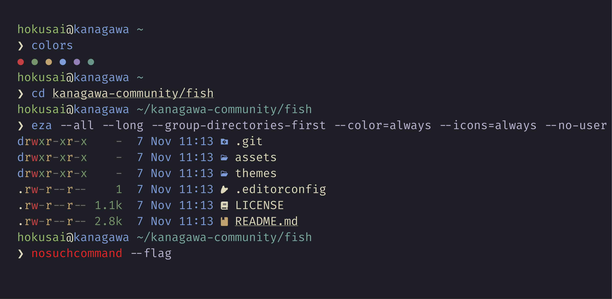
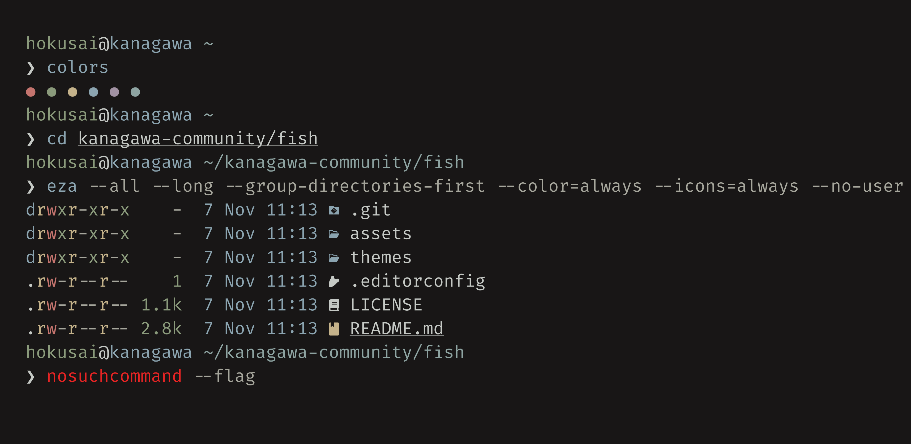
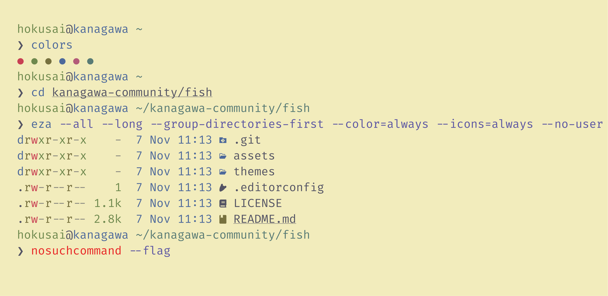

<h3>Kanagawa for <a href="https://fishshell.com">fish</a></h3>
<p>A community-maintained theme inspired by Hokusai's <em>The Great Wave off Kanagawa</em>.</p>
<p>Using the <a href="https://github.com/rebelot/kanagawa.nvim">Kanagawa palette</a> by <a href="https://github.com/rebelot">Tommaso Laurenzi (rebelot)</a>.</p>

<!-- Wave accents: carpYellow, crystalBlue, autumnRed. Lotus accents: lotusYellow, lotusBlue4, lotusRed. -->
<p>
  <a href="https://github.com/kanagawa-community/fish/stargazers">
    <picture>
      <source media="(prefers-color-scheme: dark)" srcset="https://img.shields.io/github/stars/kanagawa-community/fish?style=for-the-badge&amp;labelColor=1F1F28&amp;color=E6C384">
      <source media="(prefers-color-scheme: light)" srcset="https://img.shields.io/github/stars/kanagawa-community/fish?style=for-the-badge&amp;labelColor=F2ECBC&amp;color=77713F">
      
    </picture>
  </a>
  <a href="https://github.com/kanagawa-community/fish/releases/latest">
    <picture>
      <source media="(prefers-color-scheme: dark)" srcset="https://img.shields.io/github/v/release/kanagawa-community/fish?style=for-the-badge&amp;label=release&amp;labelColor=1F1F28&amp;color=7E9CD8">
      <source media="(prefers-color-scheme: light)" srcset="https://img.shields.io/github/v/release/kanagawa-community/fish?style=for-the-badge&amp;label=release&amp;labelColor=F2ECBC&amp;color=4D699B">
      
    </picture>
  </a>
  <a href="https://github.com/kanagawa-community/fish/issues">
    <picture>
      <source media="(prefers-color-scheme: dark)" srcset="https://img.shields.io/github/issues/kanagawa-community/fish?style=for-the-badge&amp;labelColor=1F1F28&amp;color=C34043">
      <source media="(prefers-color-scheme: light)" srcset="https://img.shields.io/github/issues/kanagawa-community/fish?style=for-the-badge&amp;labelColor=F2ECBC&amp;color=C84053">
      
    </picture>
  </a>
</p>

<br clear="both">
<br>

## Previews

<details>
<summary>🌊 Wave</summary>

</details>

<details>
<summary>🐉 Dragon</summary>

</details>

<details>
<summary>🪷 Lotus</summary>

</details>

## Requirements

- fish 3.4 or later, which reads `.theme` files from `~/.config/fish/themes`.

## Installation

Copy the theme files into your fish themes folder:

```fish
mkdir -p ~/.config/fish/themes
curl -L -o ~/.config/fish/themes/"Kanagawa Wave.theme" https://raw.githubusercontent.com/kanagawa-community/fish/main/themes/Kanagawa%20Wave.theme
```

Repeat for `Kanagawa Dragon.theme` and `Kanagawa Lotus.theme`, or clone the
repository and copy everything in `themes/`.

## Usage

Pick a variant:

```fish
fish_config theme choose "Kanagawa Wave"
```

Use `"Kanagawa Dragon"` or `"Kanagawa Lotus"` for the other variants. `fish_config`
also lists the themes in its web interface (`fish_config`, then the Colors tab).
Choosing a theme sets fish's color variables for the current session. To keep it
across sessions, run `fish_config theme save "Kanagawa Wave"`.

## Palette

Every color comes from the shared
[palette](https://github.com/kanagawa-community/.github/blob/main/PALETTE.md),
picked by role, so each variant uses its own value for the same role.

| fish variable                                                                          | Palette role    |
| -------------------------------------------------------------------------------------- | --------------- |
| `fish_color_normal`, `…_completion`                                                    | `ui.fg`         |
| `fish_color_command`, `…_host`                                                         | `syn.fun`       |
| `fish_color_keyword`                                                                   | `syn.keyword`   |
| `fish_color_quote`, `…_user`                                                           | `syn.string`    |
| `fish_color_redirection`                                                               | `syn.constant`  |
| `fish_color_end`                                                                       | `syn.punct`     |
| `fish_color_error`                                                                     | `diag.error`    |
| `fish_color_param`, `…_option`                                                         | `syn.parameter` |
| `fish_color_operator`                                                                  | `syn.operator`  |
| `fish_color_escape`                                                                    | `syn.special1`  |
| `fish_color_cwd`, `fish_pager_color_prefix`                                            | `syn.type`      |
| `fish_color_comment`, `…_autosuggestion`, `fish_pager_color_progress`, `…_description` | `syn.comment`   |
| `fish_color_cancel`                                                                    | `ui.fg_dim`     |
| `fish_color_selection`, `fish_pager_color_selected_background`                         | `ui.bg_visual`  |
| `fish_color_search_match`                                                              | `ui.bg_search`  |

## Issues and contributions

Report bugs and request changes in this port's
[issue tracker](https://github.com/kanagawa-community/fish/issues). Contributions are welcome.

See [CONTRIBUTING.md](CONTRIBUTING.md) before opening a pull request.

## License

MIT. See [LICENSE](LICENSE).
